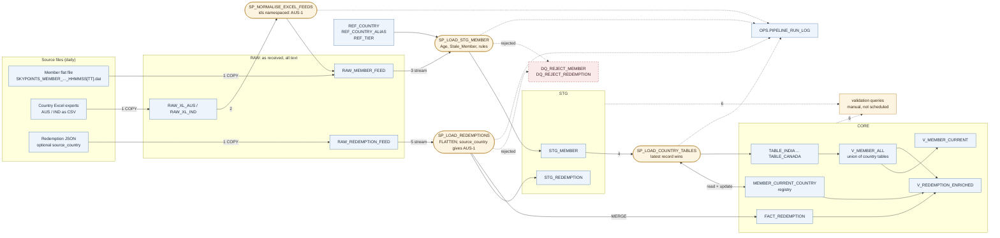

# 3. Architecture

## End-to-end flow

Rendered: [architecture.png](architecture.png). Rounded boxes are procedures, square boxes are tables and views, the
dashed box is the quarantine; dotted edges are the run log and the manual validation queries. Edge numbers follow the run order below. `P4 <--> registry`: the country split reads
each member's current country and version from the registry and updates it in the same transaction.

## Layers

| Schema | Role | Main objects | File |
|---|---|---|---|
| `RAW` | Land files exactly as received, plus lineage (file name, row number, batch timestamp) | `RAW_MEMBER_FEED`, `RAW_REDEMPTION_FEED`, `RAW_XL_*`, append-only streams | `sql/01_ddl.sql`, `sql/01b_excel_feeds.sql` |
| `STG` | Type, standardise, derive, evaluate every rule | `STG_MEMBER`, `STG_REDEMPTION` | `sql/01_ddl.sql`, `sql/02_load_staging.sql`, `sql/04_redemptions.sql` |
| `CORE` | Current state for consumers | Country tables (from `MEMBER_TEMPLATE`), registry, `FACT_REDEMPTION`, reference tables, views | `sql/01_ddl.sql`, `sql/03_split_by_country.sql`, `sql/04_redemptions.sql` |
| `DQ` | Quarantine, same shape as staging, replayable | `DQ_REJECT_MEMBER`, `DQ_REJECT_REDEMPTION` | `sql/01_ddl.sql` |
| `OPS` | Procedures, UDFs, run log | `SP_*`, `FN_XL_DATE_*`, `PIPELINE_RUN_LOG` | all |

## Run order

| Step | Object | What it does |
|---|---|---|
| 0 | `01_ddl.sql`, `01b_excel_feeds.sql` | One-off: schemas, file formats, stages, tables, streams, reference data |
| 1 | `COPY INTO` / Snowpipe | Load new files into RAW (load history prevents loading the same file twice) |
| 2 | `CALL OPS.SP_NORMALISE_EXCEL_FEEDS()` | Map each Excel layout into the canonical RAW layout; namespace IDs |
| 3 | `CALL OPS.SP_LOAD_STG_MEMBER(<business_date>)` | RAW stream to STG: type, Age, Stale_Member, rules (reference data from `REF_*`); rejects written to DQ in the same pass |
| 4 | `CALL OPS.SP_LOAD_COUNTRY_TABLES()` | Latest record wins into the country tables and the registry, from the stored watermark (`OPS.PIPELINE_WATERMARK`); pass a timestamp only to backfill |
| 5 | `CALL OPS.SP_LOAD_REDEMPTIONS()` | JSON stream flattened into STG_REDEMPTION, then MERGE into the fact |
| 6 | `05_validations.sql` | File/batch checks, run manually; each query returns rows only when something is wrong |

Steps 2 to 5 write their row counts to `OPS.PIPELINE_RUN_LOG`. **Nothing is scheduled in this repo:** the
procedures are called by hand and the validation queries are run manually. The intended production setup is a
Snowflake Task graph triggered when the streams have data (`WHEN SYSTEM$STREAM_HAS_DATA('RAW.STRM_MEMBER_FEED')`),
with step 6 failing the run if the reject-rate breaker trips; it is not scripted.

## Latest record wins

The version of a record is `(batch_ts, src_row_number)`: the timestamp in the file name, then the line number. The
newest version wins at three levels:

1. **Inside a batch:** `QUALIFY ROW_NUMBER() OVER (PARTITION BY member_id ORDER BY batch_ts DESC, src_row_number DESC) = 1`.
2. **Against history:** a record is applied only if it is newer than the version stored in `MEMBER_CURRENT_COUNTRY`,
   so a late or replayed old file is ignored, and re-running the newest batch is a no-op.
3. **Across countries:** if the winning record's country differs from the registry, the member is deleted from the old
   country table and merged into the new one, in one transaction, and the registry is updated.

Example from the demo: Ravi (`223458`) arrives in India on 15 Jan, then in the 16 Jan file with country USA.
After load 2, `TABLE_INDIA` no longer holds him, `TABLE_USA` does, and the registry says USA. Replaying the 15 Jan file
afterwards changes nothing.

## Redemptions

* `LATERAL FLATTEN` over `payload:redemptions` turns one member document into one row per transaction in
  `STG.STG_REDEMPTION`, each with its rule outcome. That table is the flattened, queryable form of the feed.
* One multi-table `INSERT ALL` over the stream writes `STG_REDEMPTION`, the quarantine and a per-run work table in a
  single pass. Only the quarantine (`DQ_REJECT_REDEMPTION`) keeps the original member document and transaction
  element, because that is what a replay needs; the staging table does not repeat the document on every row.
* Valid rows `MERGE` into `CORE.FACT_REDEMPTION` keyed on `txn_id`; a newer `feed_date` overwrites (PENDING to
  COMPLETED).
* **Join back to the member:** `FACT_REDEMPTION.member_id` to `MEMBER_CURRENT_COUNTRY.member_id` (gives the current
  country) to the member row in that country (`V_MEMBER_ALL`). It is a LEFT JOIN: a transaction whose member is
  unknown or quarantined is kept and flagged `is_orphan`. `V_REDEMPTION_ENRICHED` exposes the result.

## Designed for billions of rows a day

| Concern | Design |
|---|---|
| Ingestion | Snowpipe auto-ingest from cloud storage; COPY load history makes each file load exactly once. Files sized around 100-250 MB compressed for parallel loading. |
| Incremental processing | Append-only streams: each run reads only new rows. Streams are consumed by DML inside one transaction, so a failed run leaves them unconsumed and retries pick the same rows. |
| Compute | All steps are set-based SQL (`INSERT ... SELECT`, `MERGE`, `QUALIFY`); no row-by-row logic, no data leaves the warehouse. A dedicated, auto-suspending warehouse per pipeline, sized by volume. |
| Pruning | Clustering on `(date(batch_ts), country_code)` for staging, `member_id` for country tables and the registry, `(txn_date, member_id)` for the fact. Each run filters by `batch_ts` / load timestamp. |
| Move detection | Registry point lookup instead of scanning every country table. |
| Semi-structured data | JSON stays `VARIANT` in RAW (columnar, compressed); flattened once in staging. |
| New countries | A row in `REF_COUNTRY` (plus aliases) and `CALL OPS.SP_ENSURE_COUNTRY_TABLES()`, which creates the table and regenerates `V_MEMBER_ALL` from `REF_COUNTRY`; no code change. |
| One bad row | Never fails a batch: staging text columns are unbounded and every check is a rule, so bad values are quarantined. |

## Reliability and observability

* **Idempotent:** replaying any file or batch gives the same end state (version check plus MERGE).
* **Exactly-once:** COPY load history, stream offsets, and no DDL inside transactions (Snowflake commits implicitly on DDL).
* **Replayable:** quarantined rows keep everything needed to reprocess after a source fix.
* **Measured:** every procedure writes row counts (in, valid, rejected, moved) to `OPS.PIPELINE_RUN_LOG`;
  `05_validations.sql` queries return rows only on failure, so they plug straight into alerts.
* **Governance (recommended):** member name and DOB are personal data; apply Snowflake masking policies on the CORE
  tables and restrict RAW / DQ to the pipeline role.

## Python reference implementation

`skypoints/` implements the same rules in pandas so they can be tested without a warehouse and shown in a live demo.
It is not the production path.

| Python | SQL equivalent |
|---|---|
| `parsers.py` | COPY into RAW, `SP_NORMALISE_EXCEL_FEEDS`, `LATERAL FLATTEN` |
| `staging.py` | `SP_LOAD_STG_MEMBER` |
| `transform.py` | `SP_LOAD_COUNTRY_TABLES` |
| `redemptions.py` | `SP_LOAD_REDEMPTIONS`, `V_REDEMPTION_ENRICHED` |
| `validate.py` | `05_validations.sql` |
